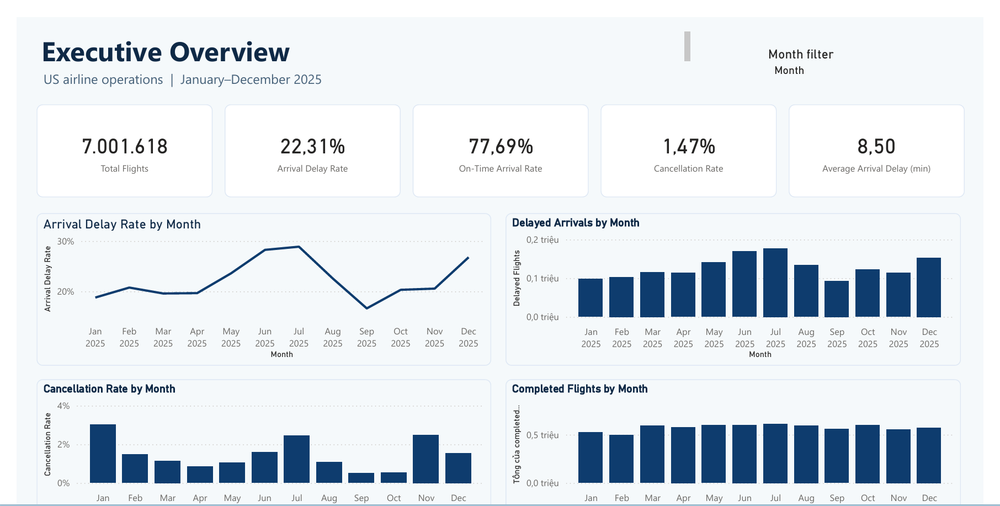
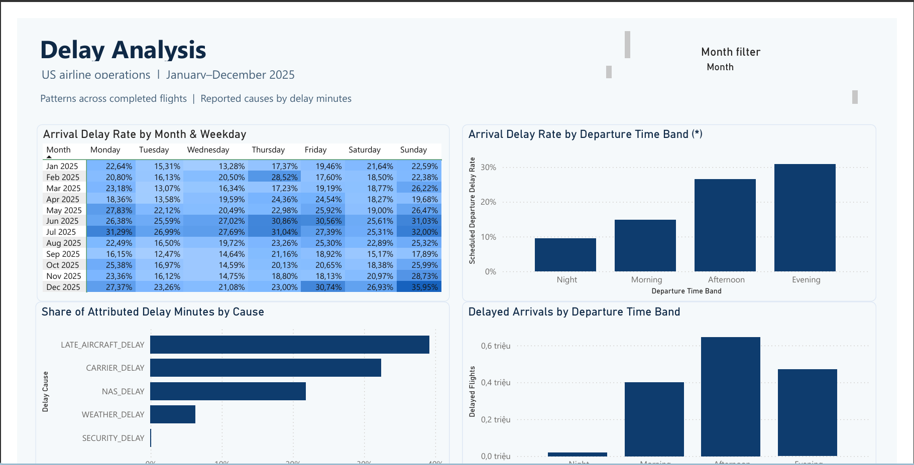
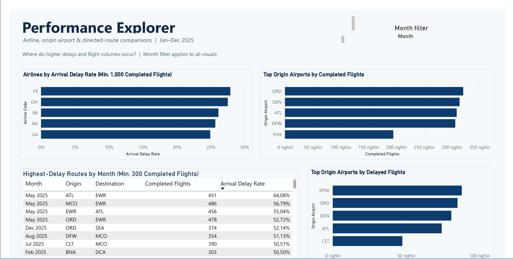
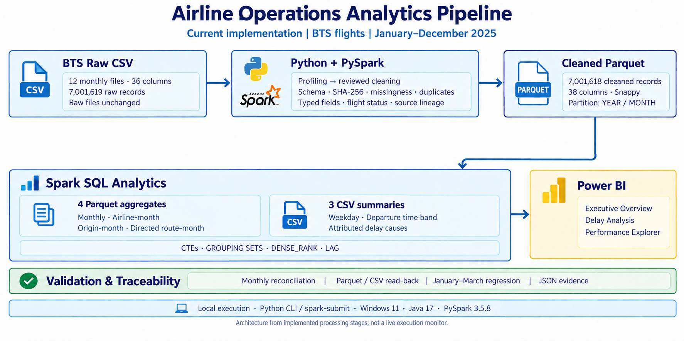

# Airline Operations Analytics | BTS Flights 2025

**Turning 7 million BTS flight records into reliable operational KPIs and a three-page Power BI dashboard.**

A Data Analyst portfolio project combining business analysis, Spark SQL and data-quality engineering to understand where flight delays occur and how performance differs across airlines, airports and routes.

**Scope:** Historical operational analysis of **January–December 2025**, from raw BTS records to validated SQL aggregates and a three-page Power BI dashboard.

[Explore the dashboard](#power-bi-dashboard) · [View results](#dataset--verified-results) · [Browse SQL](sql/analytics) · [Technical documentation](#technical-documentation)

## Business Problem

A high delay count does not necessarily mean poor relative performance: a busy airline or airport may have more delayed flights simply because it operates more flights. Conversely, a high delay rate based on very few flights can be misleading.

This project answers four operational questions:

- How do arrival delays and cancellations vary by month?
- Which airlines and directed routes have high delay rates at meaningful flight volumes?
- How does arrival performance differ by weekday and scheduled departure time?
- Which BTS reporting categories account for the largest shares of attributed delay minutes?

The objective is to support **evidence-based prioritization for further investigation**, not infer causes or claim unmeasured cost savings.

## Power BI Dashboard

The three-page dashboard moves from system-wide performance to timing patterns and targeted airline, airport and route comparisons. Open the [Power BI report](dashboard/Airline_Operations_Analytics_2025_v2.pbix); dashboard screenshots are stored in [assets/](assets/).

The completed three-page dashboard covers January–December 2025, with completion confirmed by the project owner. SQL-backed findings and dashboard observations are distinguished below.

### Executive Overview



**Purpose:** Understand the scale of operations and distinguish delay frequency, cancellations and average arrival delay.

- **KPI cards:** Total Flights, Arrival Delay Rate, On-Time Arrival Rate, Cancellation Rate and Average Arrival Delay.
- **Visuals:** Monthly arrival delay rates, delayed-arrival counts, cancellation rates and completed-flight volume.

**Finding 1 — Delay performance varies substantially by month.** More than one in five completed flights arrived at least 15 minutes late across 2025. July had both the highest monthly delay rate and the most delayed arrivals; September had the lowest rate.

| Month | Delayed / completed flights | Arrival delay rate |
| --- | ---: | ---: |
| June | 169,405 / 599,472 | 28.26% |
| July | 177,012 / 612,811 | 28.89% |
| September | 92,859 / 558,328 | 16.63% |
| December | 153,113 / 571,924 | 26.77% |

July exceeded September by **12.25 percentage points**, calculated before rounding the monthly rates. January, rather than July, had the highest cancellation rate: **16,312 / 539,747 = 3.02%**. Arrival delays and cancellations therefore identify different operational concerns.

**Decision implication:** Prioritize investigation of June–July and December while monitoring cancellations independently. The observed pattern is a within-year comparison, not proof of recurring seasonality or a forecast for the following year.

### Delay Analysis



**Purpose:** Identify observed timing patterns and examine the distribution of reported delay minutes.

- **Visuals:** A month–weekday heatmap, rates and delayed-flight counts by scheduled departure band, and attributed-minute shares by cause.

**Finding 2 — The highest-rate segment is not the highest-volume segment.** The departure-band charts display Evening as the highest-rate group and Afternoon as the group with the largest delayed-arrival count. These represent different priorities: concentrated delay exposure versus the volume of affected flights. The heatmap also shows variation within months, including a displayed **35.95%** arrival delay rate for Sundays in December.

**Metric definition:** The time-band analysis measures arrival delay by scheduled departure period: delayed arrivals divided by completed flights. It is not a departure-delay rate. No exact rates are inferred from bar lengths.

**Finding 3 — Late-aircraft and carrier categories dominate reported delay minutes.** Summing the saved monthly source totals gives **111,934,630 attributed delay minutes** across completed flights with `ARR_DEL15 = 1`.

| Reported category | Attributed minutes | Share of annual attributed minutes |
| --- | ---: | ---: |
| Late Aircraft | 43,862,971 | 39.19% |
| Carrier | 36,320,477 | 32.45% |
| National Airspace System (NAS) | 24,489,666 | 21.88% |
| Weather | 7,108,714 | 6.35% |
| Security | 152,802 | 0.14% |

Late Aircraft and Carrier together contribute **80,183,448 / 111,934,630 minutes = 71.63%**. Annual shares use sums of minutes, not averages of monthly shares; rounding individual shares can make their displayed sum differ from 100%.

**Decision implication:** Investigate flight sequencing, aircraft turnaround and carrier operations as hypotheses. These categories describe attributed **minutes**, not percentages of flights, and do not independently establish root causes. A smaller Weather category is not evidence that weather has little direct or indirect operational impact.

### Performance Explorer



**Purpose:** Compare delay rates alongside flight volume, rather than treating every high-rate group as equally informative.

| View | Interpretation |
| --- | --- |
| Top 5 airlines by arrival delay rate | Highest observed rates among airlines with at least **1,000 completed flights** in the selected reporting context |
| Top origin airports by completed and delayed flights | Two volume comparisons, not a ranking of airport-caused delays |
| High-delay routes | Directed **route-months** with at least **300 completed flights** each |

Route grain is `YEAR, MONTH, ORIGIN, DEST`: selecting multiple months does not turn these rows into a pooled annual or quarterly ranking. JFK → MVY and MVY → JFK are different routes. Volume thresholds are analytical heuristics, not statistical significance tests.

**Finding 4 — Different comparisons identify different investigation priorities.** F9 and OH lead the displayed airline delay-rate ranking. ORD leads by completed departures, while DFW leads by delayed arrivals among flights departing those airports. A high delayed-flight count alone does not establish the highest delay rate or airport responsibility.

The route table displays **ATL → EWR in May 2025: 451 completed flights and a 64.08% arrival delay rate**. Other leading rows involve MCO → EWR, EWR → ATL and ORD → EWR in May. This cluster warrants investigation by date, carrier and departure band; it does not establish EWR as the cause. These ranking examples are screenshot observations, not separately audited exports, and 64.08% is not an annual route rate.

The standalone SQL airline-ranking query orders the lowest delay rate first; this dashboard highlights the highest rates. The SQL preview's default 30-flight threshold differs from the dashboard's presentation thresholds without changing underlying KPI definitions.

### Proposed Investigation Priorities

| Priority | Proposed action | Evidence and monitoring metrics |
| --- | --- | --- |
| High | Investigate June–July and December performance | Elevated monthly rates; monitor delayed/completed counts, arrival delay rate and cancellation rate separately |
| High | Examine late-aircraft propagation and carrier operations | 71.63% of attributed minutes; track minutes alongside eligible-flight volume and reporting coverage |
| Medium | Examine Afternoon/Evening schedules | Different displayed rate/volume peaks; compare rates and delayed counts within comparable carriers and routes |
| Medium | Review the EWR-related May route-month cluster | High displayed route-month rates; retain completed-flight volume, date and direction in comparisons |

These are **investigation priorities**, not an optimized staffing plan or claims of measured improvements. Any intervention should be evaluated against comparable periods or untreated segments, considering traffic volume, route mix and operating conditions. Before–after changes alone do not establish causation; cost savings cannot be estimated without financial data.

**Business takeaway:** Combine delay rates, affected-flight counts and attributed minutes to decide where to investigate first, rather than applying the same response across every month, airport and route.

## Dataset & Verified Results

**Source:** U.S. Bureau of Transportation Statistics — [Reporting Carrier On-Time Performance](https://transtats.bts.gov/DL_SelectFields.aspx?QO_fu146_anzr=&gnoyr_VQ=FGJ).

The full-year source contains **7,001,619 records across 12 monthly CSVs**, with 36 selected BTS fields. Each row represents a reported flight record. Cleaning produces 38 columns, including `_source_file` and `flight_status`.

One completed record lacking essential arrival information was separated into a traceable rejected-record output. Raw CSVs remain unchanged; **7,001,618 records** feed full-year analytics.

| Measure | January–December 2025 |
| --- | ---: |
| Total analytical flights | 7,001,618 |
| Completed flights | 6,879,484 |
| Cancelled flights | 102,876 |
| Diverted flights | 19,258 |
| Delayed arrivals | 1,534,638 |
| On-time arrivals | 5,344,846 |
| Arrival delay rate | 22.31% |
| On-time arrival rate | 77.69% |
| Cancellation rate | 1.47% |
| Average arrival delay | 8.50 minutes |

Counts come from saved validation evidence. Rates and averages are derived from underlying counts and signed delay sums, displayed to two decimal places—not inferred from rounded screenshots. Monthly comparisons use the core analytics JSON; annual cause-minute shares sum the monthly source totals in the supplementary analytics JSON. Dashboard-only observations are explicitly identified above.

**KPI definitions**

- **Completed:** `CANCELLED = 0 AND DIVERTED = 0`; cancelled and diverted are retained as separate statuses.
- **Arrival Delay Rate:** completed flights with `ARR_DEL15 = 1` / completed flights. The label represents arrivals at least 15 minutes late.
- **On-Time Arrival Rate:** completed flights with `ARR_DEL15 = 0` / completed flights. “On time” includes early arrivals and arrivals less than 15 minutes late.
- **Cancellation / Diversion Rate:** cancelled / total, or diverted / total, respectively.
- **Average Arrival Delay:** signed `ARR_DELAY` sum / completed flights with observed `ARR_DELAY`. Early arrivals reduce this average; it is not an average over delayed flights only.

Zero denominators return NULL. Across groups or months, rates use **ratios of sums**, not averages of percentages. See [KPI Methodology](docs/kpi_definitions.md) for formulas, grain and interpretation.

## Pipeline & Technical Approach



BTS CSV → profiling → reviewed cleaning and validation → Parquet → Spark SQL aggregates → Power BI. The diagram summarizes the analytical flow; detailed quality controls are documented in the [cleaning report](docs/phase2_cleaning_report.md).

| Technology | Role |
| --- | --- |
| Python 3.11 / PySpark 3.5.8 | Ingestion, profiling, typed cleaning and validation |
| Spark SQL | KPI aggregation, airline rankings, month-over-month comparisons and delay analysis |
| Parquet / Snappy | Typed analytical storage, partitioned by YEAR/MONTH for cleaned flights |
| Power BI | KPI presentation, filtering and operational comparisons |

The project runs locally on Windows with Java 17 and a 12 GB RAM machine. It does not require a new warehouse, cloud service or orchestration framework.

**Selected implementation decisions**

- **Explainable SQL:** [Shared KPI query](sql/analytics/000_kpi_summary.sql) uses CTEs and `GROUPING SETS` for consistent monthly, airline, origin-airport and route aggregates. `DENSE_RANK()` supports comparisons; `LAG()` checks consecutive months before reporting MoM changes.
- **Correct rollups:** Aggregates retain numerators, denominators, signed delay sums and observation counts. Separate grains must not be combined in ways that double-count flights.
- **Traceable cleaning:** Validate file metadata and locally recorded SHA-256 fingerprints; preserve conditional NULLs, HHmm strings, source lineage and signed delays. No arbitrary imputation, outlier clipping or deduplication.
- **Explicit rejection policy:** Completed flights missing `ARR_TIME`, `ARR_DELAY` or `ARR_DEL15` are excluded from the analytical dataset but retained separately with source values, missing fields and a rejection reason. Missing `ARR_DELAY_NEW` alone is not a rejection condition.
- **Appropriate outputs:** Four core Parquet aggregates and three supplementary CSV summaries. Only small summaries are collected to the driver; no flight-level `toPandas()`.

## Data Quality & Validation

Full-year cleaning and both analytical runners have saved **PASS** evidence:

| Validation layer | Recorded result |
| --- | --- |
| Record accounting | 7,001,619 raw = 7,001,618 cleaned + 1 rejected |
| Cleaning | 24/24 pre-write and 17/17 read-back checks passed |
| Core SQL analytics | All four aggregate tables passed pre-write and Parquet read-back validation |
| Supplementary analytics | 97/97 checks passed; all three CSV outputs passed read-back |
| January–March regression | All four core and three supplementary aggregates passed, with zero reported mismatches |

Checks cover monthly/status reconciliation, schema, grain uniqueness, label validity, nonnegative counts, KPI formulas and NULL handling. Parquet read-back includes bidirectional `EXCEPT ALL`; regression compares keys/counts exactly and DOUBLE values with a small numeric tolerance.

Evidence is stored locally in `artifacts/phase2_2025_reviewed/validation_summary.json`, `artifacts/phase3_2025_reviewed/validation_summary.json` and `artifacts/phase3b_2025_reviewed/validation_summary.json`. January–March analytics references remain under `data/analytics/` and `artifacts/phase3b/`. Data and runtime artifacts are excluded from Git; these results are not a performance benchmark.

## Repository & Reproduction

```text
scripts/                  Pipeline entry points and diagnostic utilities
src/airline_analytics/     Schema, ingestion, cleaning and validation
sql/analytics/            KPI queries and business analyses (000–010)
docs/                     Technical methodology and historical findings
dashboard/                Power BI report (.pbix)
assets/                   Dashboard screenshots and pipeline illustrations
data/                     Local CSV, Parquet and core aggregates
artifacts/                Local validation reports and supplementary outputs
```

### Environment

Use Python 3.11, Java 17 with `JAVA_HOME`, and [requirements.txt](requirements.txt). Windows Parquet execution also requires the working Hadoop utilities configuration used for this project. Do not obtain native binaries from unverified sources.

From the repository root, create a virtual environment if needed:

```powershell
py -3.11 -m venv .venv
.\.venv\Scripts\python.exe -m pip install -r requirements.txt

$projectPython = (Resolve-Path ".\.venv\Scripts\python.exe").Path
$sparkSubmit = (Resolve-Path ".\.venv\Scripts\spark-submit.cmd").Path
$env:PYSPARK_PYTHON = $projectPython
$env:PYSPARK_DRIVER_PYTHON = $projectPython
$env:PYTHONPATH = (Resolve-Path ".\src").Path
$sparkOptions = @("--master", "local[1]", "--driver-memory", "3g")
```

### Execution entry points

| Step | Script |
| --- | --- |
| Validate and profile raw CSVs | [profile_raw_data.py](scripts/profile_raw_data.py) |
| Investigate missing arrival fields | [diagnose_arrival_missing.py](scripts/diagnose_arrival_missing.py) |
| Write accepted/rejected outputs and validate | [build_cleaned_parquet.py](scripts/build_cleaned_parquet.py) |
| Build core aggregates and preview business queries | [build_analytics.py](scripts/build_analytics.py) |
| Build weekday, departure-band and cause summaries | [run_phase3b.py](scripts/run_phase3b.py) |

The current configuration expects twelve files named `reporting_carrier_ontime_2025_01.csv` through `reporting_carrier_ontime_2025_12.csv` with the fields in the [data dictionary](docs/data_dictionary.md). File fingerprints are specific to the reviewed exports; different exports require review.

**Reproduction prerequisites:** Datasets, diagnostic approvals, validation JSON and historical January–March regression references are not bundled with the repository. Current full-year runners require these inputs; a fresh clone is not a one-command end-to-end run. Cleaning explicitly requires `--approved-diagnostic`. Inspect each script's `--help` for its paths and dependencies.

For example, with the reviewed cleaned Parquet, Phase 2 evidence and MVP core aggregates already available, rebuild core analytics into new paths:

```powershell
& $sparkSubmit @sparkOptions ".\scripts\build_analytics.py" `
    --input-dir ".\data\processed\flights_cleaned_2025_reviewed" `
    --phase2-report ".\artifacts\phase2_2025_reviewed\validation_summary.json" `
    --mvp-analytics-dir ".\data\analytics" `
    --output-dir ".\data\analytics\2025_reviewed_rerun" `
    --validation-output ".\artifacts\phase3_2025_rerun\validation_summary.json"

if ($LASTEXITCODE -ne 0) { throw "Analytics failed; review the validation report." }
```

Existing outputs are refused, not silently overwritten. Preserve prior evidence and choose fresh paths for deliberate reruns. In Power BI Desktop, update local Power Query paths before refreshing; generated Spark part filenames may differ between runs.

## Technical Documentation

- [Data Dictionary](docs/data_dictionary.md) — fields, types, units and conditional NULLs.
- [Data Quality Report](docs/data_quality_report.md) — profiling rules and their limitations.
- [Cleaning Report](docs/phase2_cleaning_report.md) — type handling, lineage and Parquet validation.
- [KPI Methodology](docs/kpi_definitions.md) — populations, formulas, SQL logic and rollup pitfalls.
- [Business Findings](docs/phase3b_findings.md) — weekday, departure-band and cause-minute interpretation.

The reports explain the current full-year methodology and retain explicitly labeled January–March regression references.

## Interpretation & Limitations

- The analytical dataset and illustrated dashboard cover one year. This does not establish a recurring multi-year seasonal pattern.
- Findings are observational. Airline, airport and route mix can affect comparisons; correlation does not establish causation.
- Arrival delay rates exclude cancelled/diverted flights and the rejected record. They do not capture every form of passenger disruption.
- Cause-minute shares are not percentages of delayed flights. Thresholds are adjustable heuristics, not confidence guarantees.
- Validation covers the implemented checks, not perfect source data or every dashboard filter context. No production performance benchmark or measured financial impact is claimed.

The portfolio scope is descriptive business analytics and data-quality engineering, delivered through validated data processing, SQL analysis and a completed Power BI dashboard. Predictive modeling is outside this scope.
